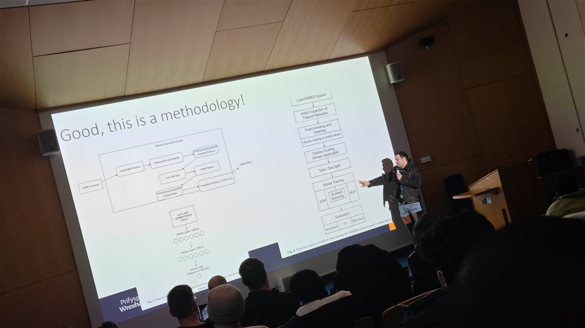

On Wednesday 28 October 2026 I walked across the stage at Wrexham University and graduated with an MSc in Cybersecurity, with Distinction. This isn't a write-up of a single build like most posts here. It's a look back at the course (January 2025 to April 2026), the two pieces of work I'm proudest of, and the people who made it possible. The code for both is on GitHub: the [dissertation testbed](https://github.com/Bill-Benson/Modsecurity-crs-paranoia-evaluation) and the [Sentinel detection project](https://github.com/Bill-Benson/sentinel-waf-detection).

<figure>
  
  <figcaption>Graduation day at Wrexham University, 28 October 2026.</figcaption>
</figure>

## Getting Here

I moved to the UK specifically to do this degree. I came to it from a job configuring and supporting firewalls for clients in Lagos, so the course was a chance to look at the same kind of controls from the research side: not "how do I set this up", but "how well does it actually work, and how would I prove it".

The year was a lot. The modules covered offensive security and incident response, networking and defensive security, machine learning and research methods, and the dissertation sat on top of all of it. There were long nights in the lab, a lot of containers that wouldn't start for reasons that turned out to be one wrong line of config, and one moment I didn't see coming.

In the Advanced Machine Learning module, my lecturer put my methodology diagrams up in front of the whole class under the heading "Good, this is a methodology!". It was the pipeline for my malware classification project: loading the EMBER subset, cleaning and scaling the features, then training and evaluating an SVM, gradient boosting and an MLP side by side. Sitting in the lecture theatre watching my own figures on the big screen was a strange and very good feeling. The project itself is written up in [SVM vs LightGBM vs a Neural Net for Static Malware Detection](/blog/malware-detection-model-comparison).

<figure>
  
  <figcaption>My malware classification methodology, used as the example in class.</figcaption>
</figure>

## The Dissertation Finding

The question was simple: does raising ModSecurity's paranoia level actually improve detection? I tested OWASP Core Rule Set 3.3.8 at Paranoia Level 1 against Paranoia Level 2, using 200 SQLi and XSS payloads and 500 benign requests, in a Docker NGINX testbed defined as code.

I went in expecting PL2 to buy some extra detection. It didn't.

- Detection was **97.0% at both levels**.
- False positives **doubled, from 1.0% to 2.0%**.
- All **37 rules that fired were PL1 rules**. Not one PL2-specific rule matched anything.
- The only operative change between the two configurations was the anomaly threshold dropping from 5 to 3.
- Six payloads bypassed both levels, which no threshold setting could have fixed.

**Raising the paranoia level changed a number, not the rules doing the detecting.** The extra false positives came from requests that already scored 3 under PL1 and were simply allowed through until the threshold fell to meet them. I'm glad it came out this way, because a result that contradicts the documentation's implicit assumption is more useful than one that confirms it. The full method, tables and bypass breakdown are in [Do Higher WAF Paranoia Levels Actually Improve Detection?](/blog/waf-paranoia-level-evaluation).

## The Project That Followed

Once the dissertation was submitted, one question kept bothering me. If some attacks get past the WAF at every paranoia level, the WAF's own logs will never show them. So can you catch them afterwards from logs alone?

That became a separate project, built on the dissertation data but not part of it. I set up a Microsoft Sentinel workspace and pushed the logs in through the Azure Monitor Logs Ingestion API: a Data Collection Endpoint, a Data Collection Rule, two custom tables (`WAFAudit_CL` and `WAFAccess_CL`) and a Python parser, about 5,000 events in total. A KQL `leftanti` join then subtracted what the WAF flagged from what the server answered with HTTP 200, and what was left was a boolean-blind SQLi payload that sailed through both paranoia levels, one I already knew about from the dissertation. Finding it again from logs with no prior knowledge baked in was the point. The detail is in [Catching the Attacks a WAF Misses with Microsoft Sentinel](/blog/waf-bypass-detection-sentinel).

The two projects fit together for me. The dissertation measured a control, and the Sentinel project assumed the control would fail and asked what you do next.

## Thank You

To my lecturers at Wrexham. Dr Colin Kuka supervised my dissertation and helped me turn a simple question into a study that could actually answer it. Shawn Price was my first lecturer on the course, teaching offensive security and secure computing. His classes were the ones I looked forward to most because they were hands-on and interactive, and he was generous with his time well beyond the classroom. I'm grateful to both of them for taking the work seriously.

To my classmates, for the late-night debugging, the shared notes, and the reminder that everyone else's container was also broken at 1am.

To my family and friends, near and far, who cheered me on from a distance and put up with a lot of "I'll call you after this run finishes".

## What's Next

I'm excited to keep building in security, especially around SOC work, detection engineering and network security, where the two halves of this degree meet: understanding how controls are meant to work and checking whether they do. I'll keep writing up what I build here. The next posts will go back to being technical.
